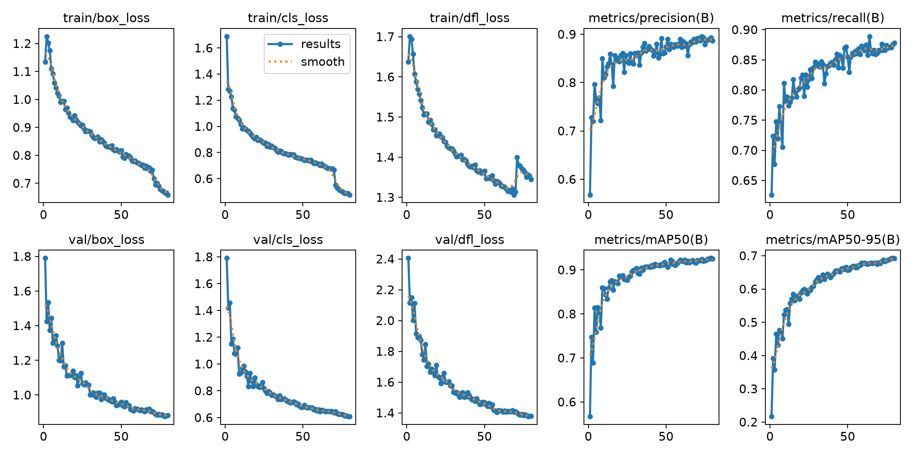
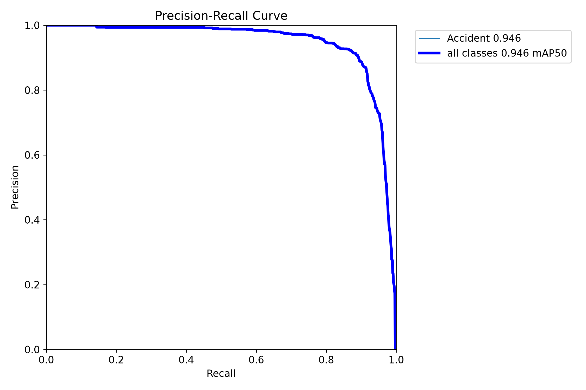
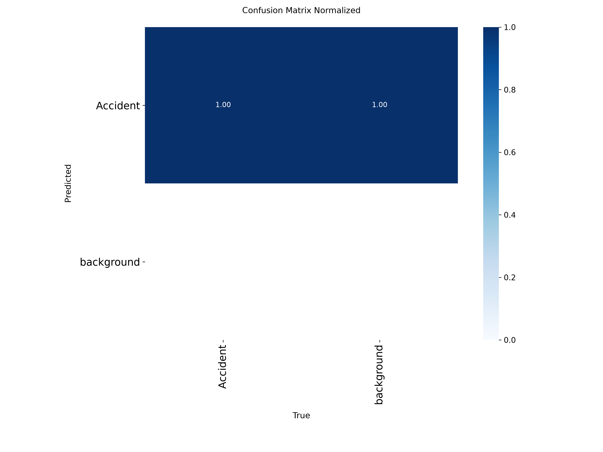

# AlertaVida — Visão computacional

Esta pasta reúne o treinamento do detector de acidentes, ferramentas de validação e scripts históricos de processamento de vídeos. O dashboard não executa estes scripts: a Galeria de Detecções apresenta vídeos previamente processados.

## Estrutura

- `src/train.py`: treinamento customizado a partir dos pesos base.
- `models/yolo11n.pt`: checkpoint base YOLO11n usado no treinamento.
- `assets/samples/`: imagens de exemplo auxiliares, incluindo `bus.jpg`.
- `dataset/processed_clean/Accident_Detection/Dataset/`: dataset preparado e `data.yaml`.
- `tools/validation/`: análises do dataset/modelo e folhas de revisão.
- `tools/video_processing/`: scripts reproduzíveis de processamento de lotes históricos.
- `tools/archive/`: utilitários de preparação/teste antigos; estão preservados para referência e não fazem parte do fluxo atual.
- `videos/gallery/`: manifesto e vídeos publicados na galeria do dashboard.
- `runs/`: resultados históricos e novos treinamentos, incluindo métricas, gráficos, matrizes de confusão, checkpoints e saídas de processamento.

Os resultados históricos estão organizados em `computer-vision/runs/`. A execução principal está em `runs/detect/runs/alertavida_yolo11n/`, e as avaliações estão em `runs/detect/results/`.

## Origem e preparação do dataset

O projeto utiliza o dataset **Accident Detection**, publicado no Mendeley Data com o título **AccidentDetection-9k: An Annotated Road Accident Image Dataset for Object Detection**. O registro oficial consultado é a versão 2, publicada em 1º de setembro de 2026, DOI `10.17632/4x5my8gbcs.2`. Os colaboradores indicados são Farzana Akter Mily, Md Ibrahim Shikder Mahin e Md Shamsul Arefin. A licença indicada pelo registro é **CC BY 4.0**.

[Abrir a publicação oficial no Mendeley Data — versão 2](https://data.mendeley.com/datasets/4x5my8gbcs/2)

**Referência bibliográfica:** Mily, Farzana Akter; Mahin, Md Ibrahim Shikder; Arefin, Md Shamsul. (2026). *AccidentDetection-9k: An Annotated Road Accident Image Dataset for Object Detection* (versão 2). Mendeley Data. [https://doi.org/10.17632/4x5my8gbcs.2](https://doi.org/10.17632/4x5my8gbcs.2). Licença: CC BY 4.0.

Ao reutilizar ou redistribuir o dataset, respeite os termos da licença e atribua o crédito aos colaboradores/autores indicados no registro.

**Rastreabilidade da cópia local:** o ZIP atualmente usado pelo projeto contém a estrutura do dataset e um `data.yaml`, mas não identifica o DOI nem a versão do registro. Portanto, não é possível confirmar apenas pelo ZIP que a cópia local corresponde exatamente à versão 2. Para reproduzir a origem documentada, baixe explicitamente a versão 2 pelo registro acima.

### Baixar e extrair

1. No PowerShell, a partir de `computer-vision/`, crie a pasta local para o arquivo original:

```powershell
New-Item -ItemType Directory -Force .\dataset\raw | Out-Null
```

2. Na página oficial, use **Download All** e salve o ZIP como `Accident_Detection.zip` em `computer-vision/dataset/raw/`. Essa pasta e o dataset são locais e estão excluídos do Git.
3. Ainda a partir de `computer-vision/`, extraia o ZIP para `dataset/processed_clean/`:

```powershell
Expand-Archive -LiteralPath .\dataset\raw\Accident_Detection.zip -DestinationPath .\dataset\processed_clean
```

4. Confira que o layout extraído é `dataset/processed_clean/Accident_Detection/Dataset/`, com `train/`, `valid/`, `test/` e `data.yaml`. Se a exportação trouxer uma linha `path:` apontando para uma máquina ou diretório externo, remova essa linha: o YAML deste projeto usa caminhos relativos à própria pasta do arquivo. O conteúdo esperado é:

```yaml
train: train/images
val: valid/images
test: test/images

nc: 1
names:
  0: Accident
task: detect
```

Verifique as pastas e exiba o YAML no PowerShell:

```powershell
$dataset = ".\dataset\processed_clean\Accident_Detection\Dataset"
foreach ($item in @("data.yaml", "train/images", "valid/images", "test/images")) {
    $path = Join-Path $dataset $item
    if (-not (Test-Path -LiteralPath $path)) { throw "Não encontrado: $path" }
    Write-Host "OK: $path"
}
Get-Content (Join-Path $dataset "data.yaml")
```

O treinamento usa o YOLO11n pré-treinado como ponto de partida, o dataset preparado localmente acima e os pesos base em `computer-vision/models/yolo11n.pt`. A execução padrão grava os resultados em `computer-vision/runs/detect/runs/alertavida_yolo11n/`, que também é o local padrão de `weights/best.pt` usado pelos scripts de processamento e validação.

## Ambiente Python e dependências

O ambiente inspecionado usa Python 3.11.9. As dependências Python da visão computacional estão fixadas em `requirements.txt`. PyTorch e Torchvision ficam fora desse arquivo para que a instalação CUDA seja explícita e compatível com o ambiente usado.

No PowerShell, a partir desta pasta, crie um ambiente virtual e instale primeiro as wheels CUDA de PyTorch/Torchvision:

```powershell
py -3.11 -m venv .venv
.\.venv\Scripts\python.exe -m pip install --upgrade pip
.\.venv\Scripts\python.exe -m pip install torch==2.14.1 torchvision==0.29.1 --index-url https://download.pytorch.org/whl/cu132
.\.venv\Scripts\python.exe -m pip install -r requirements.txt
.\.venv\Scripts\python.exe -c "import torch; print(torch.__version__); print('CUDA disponível:', torch.cuda.is_available())"
```

Não é necessário ativar o ambiente com `Activate.ps1`; chamar diretamente o `python.exe` evita problemas de política de execução do PowerShell. O comando CUDA acima corresponde à combinação observada no ambiente analisado. O uso de CUDA também depende de GPU NVIDIA e driver compatível; sem CUDA, o treinamento configurado em `device=0` não inicia.

## Dataset e portabilidade

O arquivo `dataset/processed_clean/Accident_Detection/Dataset/data.yaml` não define uma raiz `path`. Na versão instalada do Ultralytics, quando `path` não é definido, a raiz é derivada do diretório do próprio YAML (`yaml_file.parent`). Como as divisões estão em `train/images`, `valid/images` e `test/images`, os caminhos ficam relativos à pasta real do dataset e não à pasta atual do terminal. A chave de validação é `val`, apontando para `valid/images`.

`src/train.py` resolve seus caminhos padrão relativamente à raiz `computer-vision/`, valida que o YAML e os pesos base existem e passa o caminho absoluto do YAML ao Ultralytics. Caminhos relativos informados por `--data`, `--model` ou `--project` também são resolvidos desde essa raiz. Para usar outro dataset ou checkpoint, informe caminhos absolutos ou relativos ao diretório `computer-vision/`.

## Treinamento

O treinamento não é executado ao instalar as dependências. Quando autorizado, a partir desta pasta:

```powershell
.\.venv\Scripts\python.exe .\src\train.py
```

Para executar a partir de outra pasta, indique a pasta `computer-vision` do clone e use os caminhos absolutos resolvidos localmente; os padrões continuam relativos ao projeto:

```powershell
$cvRoot = (Resolve-Path "<caminho-do-clone>\computer-vision").Path
& "$cvRoot\.venv\Scripts\python.exe" "$cvRoot\src\train.py"
```

Parâmetros disponíveis:

```powershell
.\.venv\Scripts\python.exe .\src\train.py --data "dataset\processed_clean\Accident_Detection\Dataset\data.yaml" --model "models\yolo11n.pt" --project "runs\detect\runs" --name "alertavida_yolo11n"
```

Por padrão, os novos resultados são gravados em `computer-vision/runs/detect/runs/alertavida_yolo11n/`. O script usa `exist_ok=False`, portanto não reutiliza nem sobrescreve uma execução existente. Se essa pasta já existir, escolha outro `--name`; nesse caso, defina `ALERTAVIDA_MODEL_PATH` para o `weights/best.pt` da nova execução antes de usar os scripts de processamento e validação.

## Pesos customizados para ferramentas

Os scripts de análise e processamento procuram por padrão o checkpoint em `runs/detect/runs/alertavida_yolo11n/weights/best.pt`, relativo à raiz `computer-vision/`. Para conferir se ele existe sem carregar o modelo ou executar inferência, rode a partir de `computer-vision/`:

```powershell
$checkpoint = ".\runs\detect\runs\alertavida_yolo11n\weights\best.pt"
if (Test-Path -LiteralPath $checkpoint -PathType Leaf) {
    (Resolve-Path -LiteralPath $checkpoint).Path
} else {
    throw "Checkpoint não encontrado: $checkpoint"
}
```

Para usar outro checkpoint, `ALERTAVIDA_MODEL_PATH` aceita um caminho relativo a `computer-vision/` ou absoluto. Exemplo para uma nova execução:

```powershell
$env:ALERTAVIDA_MODEL_PATH = ".\runs\detect\runs\<nome-da-execucao>\weights\best.pt"
```

Os scripts usam caminhos de dados e saída derivados da localização do próprio arquivo; não precisam ser chamados a partir de `computer-vision/`. Os scripts em `tools/archive/` são históricos e alguns podem preparar ou substituir saídas se forem executados. Revise o código e os destinos antes de usá-los.

## Ferramentas de validação

`tools/validation/` contém verificações de duplicatas, inspeções de exemplos negativos, revisão visual do dataset, análise de confiança e geração de contact sheets. As análises que usam o detector também precisam dos pesos customizados e de GPU CUDA, exceto quando o próprio script permite ajustar o dispositivo.

`tools/video_processing/` contém processadores de lotes e o reprocessador de três vídeos. Eles executam inferência e gravam arquivos de saída; use-os somente ao reproduzir essas análises e confira o destino antes de iniciar. Esta organização não executa nenhum deles.

Os vídeos de entrada não são distribuídos no repositório. Para reproduzir o processamento, obtenha os arquivos de entrada com autorização, coloque-os nas pastas locais indicadas e execute a partir de `computer-vision/`:

| Script | Entrada local | Saída local | Configuração |
| --- | --- | --- | --- |
| `tools/video_processing/process_candidates.py` | `videos/candidates/` | `videos/candidates_output/` | `conf=0.50`, CUDA 0, `imgsz=640` |
| `tools/video_processing/process_candidates_batch2.py` | `videos/candidates_batch2/` | `videos/candidates_batch2_output/` | `conf=0.50`, CUDA 0, `imgsz=640` |
| `tools/video_processing/reprocess_first_round_review.py` | `videos/candidates/` | `videos/first_round_review_conf070/` | `conf=0.70`, CUDA 0, `imgsz=640` |

Exemplo de execução, sem ativar o ambiente virtual:

```powershell
.\.venv\Scripts\python.exe .\tools\video_processing\process_candidates.py
```

Os outros dois scripts podem ser executados pelo mesmo padrão, substituindo o nome do arquivo. O processamento gera métricas e vídeos; os arquivos de entrada e os resultados locais não fazem parte do clone público. Os utilitários em `tools/archive/` são históricos e podem gravar ou substituir saídas; revise seus destinos e dependências antes de executá-los.

## Resultados e limitações

As métricas abaixo são os valores finais da partição de validação, registrados na época 80 em `runs/detect/runs/alertavida_yolo11n/results.csv`. Elas **não são métricas de um teste independente**:

| Precision | Recall | mAP50 | mAP50-95 |
| ---: | ---: | ---: | ---: |
| 0,88695 | 0,87838 | 0,92575 | 0,69207 |



O gráfico acompanha as perdas e as métricas ao longo das épocas. Em geral, perdas menores e métricas de validação maiores ou estáveis indicam aprendizado; oscilações entre épocas são esperadas e devem ser interpretadas junto com os resultados finais.



A curva mostra como precisão e recall variam conforme o limiar de confiança muda. Ela ajuda a visualizar o compromisso entre encontrar mais acidentes e reduzir falsos positivos.



A matriz resume, em proporções, como as detecções se comparam às classes reais: a diagonal representa correspondências e as outras células representam erros de classificação ou detecção.

As duas últimas imagens estão armazenadas em `runs/detect/results/test_evaluation/`. A origem exata dessa avaliação não está documentada o suficiente para afirmá-la como teste independente; por isso, elas não são usadas para rotular as métricas da tabela acima.

O modelo é um detector customizado para a classe `Accident`; seus resultados podem incluir falsos positivos ou deixar de detectar colisões. A galeria é uma demonstração com vídeos gravados e resultados previamente processados. Ela não representa monitoramento ao vivo nem confirmação automática de acidentes.
