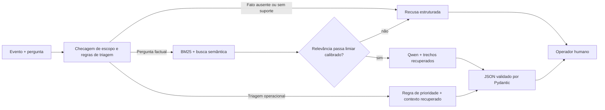

# AlertaVida · Generative AI for Engineering

- Vídeo mostrando o MVP: https://youtu.be/lyxsTVF79Ew

**Monitoramento inteligente de acidentes de trânsito com apoio de inteligência artificial.**

O AlertaVida é uma solução tecnológica que propõe utilizar visão computacional e análise de dados para identificar possíveis acidentes de trânsito em sistemas de câmeras urbanas, gerar alertas e encaminhá-los às equipes responsáveis pela verificação e eventual acionamento dos serviços de emergência.

A proposta é desenvolver uma solução que possa ser integrada à infraestrutura de monitoramento de diferentes municípios, contribuindo para uma identificação mais rápida de ocorrências e um melhor encaminhamento de possíveis vítimas.

LLM local (`Qwen2.5-1.5B-Instruct`) que recebe um evento de possível acidente
(gerado pela visão computacional) e devolve uma **triagem em JSON** com fontes,
ou uma **recusa** quando a base não sustenta a resposta. O projeto compara três
configurações: sem contexto, RAG e RAG + LoRA.


## Ficha do produto

| Campo | Descrição |
|---|---|
| **Nome do produto** | AlertaVida |
| **Cidadão e território** | Pessoas envolvidas em acidentes de trânsito em áreas urbanas, com aplicação prevista para centrais de monitoramento municipais. |
| **Problema** | Possíveis acidentes podem demorar para ser identificados, avaliados e encaminhados às equipes responsáveis. |
| **Entrada** | Evento simulado de visão computacional e pergunta do operador. |
| **Saída** | JSON de triagem com tipo provável, prioridade, informações identificadas/ausentes, próximo passo, referências ou recusa. |
| **Proposta de valor** | Transformar sinais capturados por câmeras em alertas contextualizados, com triagem assistida por IA, referências de apoio e dados territoriais para orientar a validação humana. |
| **Arquitetura** | Câmeras e vídeos → modelo de visão computacional → API FastAPI do MVP → painel React/Vite → módulo GenAI com RAG, geração e validação de JSON → Databricks SQL Warehouse, mapa, indicadores e central de triagem. |
| **Fontes de dados** | Vídeos usados no desenvolvimento, eventos e indicadores no Databricks SQL Warehouse e base documental institucional em `base/trechos.jsonl` e `base/fontes.csv`. |
| **Modelos de IA** | YOLO11n personalizado para detecção de acidentes; `Qwen/Qwen2.5-1.5B-Instruct` para geração local; `intfloat/multilingual-e5-small` para busca semântica; adaptador LoRA opcional para RAG + LoRA. |
| **Repositório e interfaces locais** | Repositório: https://github.com/guidxs/AlertaVida · MVP: http://localhost:5173/ · GenAI: http://localhost:8001/ |
| **Indicadores de impacto** | Quantidade de ocorrências identificadas, precisão e recall das detecções, tempo de identificação e encaminhamento, tempo de triagem, taxa de JSON válido, citação correta e recusa correta. |
| **ODS 3** | Apoia a identificação e o encaminhamento mais rápidos de possíveis acidentes. |
| **ODS 9** | Aplica IA, dados e infraestrutura digital a um desafio de segurança viária. |
| **ODS 10** | Busca apoiar o acesso mais equitativo à ajuda, sem depender da capacidade financeira da pessoa. |

## Integrantes

| Nome completo | RM |
|---|---|
| Guilherme Doretto Sobreiro | 99674 |
| Guilherme Fazito Ziolli Sordili | 550539 |

## Configuração técnica

- **Modelo:** `Qwen/Qwen2.5-1.5B-Instruct`, execução local e geração determinística.
- **Embeddings:** `intfloat/multilingual-e5-small`, com prefixos `query:` e `passage:`.
- **Configurações avaliadas:** sem contexto, RAG e RAG + LoRA.
- **LoRA:** r=16, alpha=32, dropout=0.05, módulos q/k/v/o, 3 épocas,
  learning rate 2e-4, batch 1, acumulação 8 e MAXLEN 1024.
- **Segurança:** eventos simulados, sem reconhecimento facial, sem acionamento
  real de serviços e com validação humana obrigatória.
- **LGPD:** não são usados dados pessoais nos casos ou na API.

## Pipeline



## Estrutura

| Caminho | Conteúdo |
|---|---|
| `base/` | `trechos.jsonl` e `fontes.csv` |
| `avaliacao/` | conjuntos sintéticos, limiar e placares finais; diagnósticos intermediários em `diagnosticos/` |
| `alertavida/` | busca, prompt, geração, validação, métricas, placar e treino LoRA |
| `notebooks/` | 01 base · 02 busca · 03 RAG · 04 LoRA · 05 placar |
| `api/` | FastAPI com `POST /triage` |

## Como reproduzir

### Linux/macOS

```bash
python -m venv .venv
source .venv/bin/activate
pip install -r requirements.txt
jupyter lab
```

### Windows PowerShell

```powershell
python -m venv .venv
.\.venv\Scripts\Activate.ps1
pip install -r requirements.txt
jupyter lab
```

Execute os notebooks em ordem, de `01_base.ipynb` a `05_placar.ipynb`. Os
conjuntos sintéticos podem ser recriados com:

```bash
python scripts/gerar_avaliacao_ampliada.py
python scripts/ampliar_casos_treino.py
```

Calibre o limiar somente na validação:

```bash
python scripts/calibrar_limiar.py
python scripts/preparar_teste_final.py
```

O placar por paráfrases pode ser recomposto sem inferência a partir dos arquivos
`avaliacao/resultados_parafrase_*.jsonl`; o notebook 05 lê esses arquivos.
Para repetir a inferência:

```bash
python -m alertavida.treinar_lora
python -m alertavida.placar
python -m alertavida.treinar_lora --dados avaliacao/casos_treino_ampliado.jsonl --saida modelos/lora_alertavida_retreinado
python -m alertavida.placar --casos avaliacao/casos_teste_desenvolvimento.jsonl --saida-prefix desenvolvimento_ --adaptador modelos/lora_alertavida
python -m alertavida.placar --casos avaliacao/casos_teste_parafrase.jsonl --saida-prefix parafrase_ --adaptador modelos/lora_alertavida
```

Todo novo treino grava em um adaptador separado
(`modelos/lora_alertavida_retreinado` por padrão) e não sobrescreve o adaptador
original. Os pesos experimentais não fazem parte da entrega pública.

No Windows, cada notebook também pode ser executado sem ativar o ambiente:

```powershell
.\.venv\Scripts\jupyter.exe nbconvert --to notebook --execute --inplace --ExecutePreprocessor.timeout=-1 notebooks\01_base.ipynb
```

Repita em ordem para `02_busca.ipynb`, `03_rag.ipynb`, `04_lora.ipynb` e
`05_placar.ipynb`.

## API

```bash
uvicorn api.main:app --port 8000
```

Para selecionar RAG + LoRA:

```bash
LORA=1 uvicorn api.main:app --port 8000
```

No PowerShell:

```powershell
$env:LORA = "1"
uvicorn api.main:app --port 8000
```

A interface fica em http://localhost:8000/. Exemplo de chamada em Bash:

```bash
curl -X POST localhost:8000/triage -H "Content-Type: application/json" \
  -d '{"evento":{"camera_id":"CAM-01","timestamp":"2026-11-10T14:32:05","event_type":"possivel_colisao","confidence":0.87}}'
```

No PowerShell:

```powershell
$payload = @{ evento = @{ camera_id = "CAM-01"; timestamp = "2026-11-10T14:32:05"; event_type = "possivel_colisao"; confidence = 0.87 } } | ConvertTo-Json -Depth 4
Invoke-RestMethod -Uri http://localhost:8000/triage -Method Post -ContentType "application/json" -Body $payload
```

Os modelos podem ser trocados pelas variáveis `LLM_ID` e `EMB_ID`.

## Base de conhecimento

| Fonte | Formato | Licença / uso | Trechos ativos |
|---|---|---|---:|
| [F01 Ministério da Saúde, SAMU 192](https://www.gov.br/saude/pt-br/composicao/saes/samu-192) | HTML | CC BY-ND 3.0 | 9 |
| [F02 Lei 9.503/1997 (CTB)](https://www.planalto.gov.br/ccivil_03/leis/l9503compilado.htm), arts. 176, 177 e 304 | HTML | Domínio público | 7 |
| [F03 Portaria GM/MS 2.048/2002](https://bvsms.saude.gov.br/bvs/saudelegis/gm/2002/prt2048_05_11_2002.html) | HTML | Ato normativo oficial | 1 |
| [F04 PRF, Plano de Dados Abertos 2024–2026](https://www.gov.br/prf/pt-br/acesso-a-informacao/plano_de_dados_abertos_2024_final.pdf) | PDF | Glossário; não licencia o PDF | 0 |
| [F05 AEN-PR, emergência em rodovias](https://www.aen.pr.gov.br/sites/default/arquivos_restritos/files/documento/2021-11/apresentacao.pdf) | PDF | Reprodução com crédito; fonte antiga | 0 |
| [F06 Critério do AlertaVida](https://github.com/guidxs/AlertaVida) | Texto | Regra interna do grupo | 1 |
| [F07 Ministério da Saúde, campanha SAMU 192](https://www.gov.br/saude/pt-br/campanhas-da-saude/2025/samu-192) | HTML | Termos do portal | 1 |
| [F08 Ministério dos Transportes](https://www.gov.br/transportes/pt-br/assuntos/transporte-terrestre_/rodovias-federais/rodovias-federais-perguntas-frequentes-acidentes-em-rodovias) | HTML | Termos do portal | 3 |
| [F09 PRF, telefone de emergência](https://www.gov.br/prf/pt-br/canais-de-atendimento/unidades-prf/sede-nacional) | HTML | Termos do portal | 1 |
| [F10 Defesa Civil de Santa Catarina](https://www.defesacivil.sc.gov.br/emergencia-com-produtos-perigosos/) | HTML | Termos do portal; escopo SC | 1 |
| [F11 PRF, produtos perigosos no Paraná](https://www.gov.br/prf/pt-br/noticias/estaduais/parana/2023/junho/prf-orienta-motoristas-em-caso-de-acidentes-envolvendo-produtos-perigosos/) | HTML | Termos do portal; escopo PR | 1 |

São 25 trechos ativos. F04 e F05 permanecem no inventário de fontes, mas não
entram no índice de recuperação. O Ministério da Saúde declara CC BY-ND 3.0
para seu conteúdo; os itens da base são resumos autorais com atribuição e sua
compatibilidade ainda deve ser revista antes de redistribuir conteúdo.

As páginas institucionais não indicam licença aberta geral. Seus termos devem ser
verificados antes da redistribuição. A definição de dados abertos da PRF não
licencia o PDF; a fonte regional da AEN-PR foi retirada da busca ativa porque
pode conflitar com orientações federais mais recentes.

A prioridade de T020 é uma regra interna do grupo: alta para vítima confirmada,
pessoa presa às ferragens, pessoa caída ou produto perigoso; média para alerta
sem informação de vítimas; baixa quando o operador confirma apenas danos
materiais.

## Conjuntos de avaliação

- Conjunto legado: 42 casos de treino e 32 casos de teste sintéticos.
- Revisão ampliada: 81 exemplos de treino, 24 de validação e 32 de teste.
- Não há perguntas textualmente repetidas entre os três conjuntos ampliados.
- Os casos foram escritos a partir das mesmas fontes e não representam
  validação em ocorrências reais.
- Fatos e gabaritos do teste por paráfrases são os mesmos dos 32 cenários de
  desenvolvimento; as perguntas foram reescritas.

## Busca e recuperação

- Trechos ativos: 25.
- Recuperação híbrida: BM25 lexical, termos, números, artigos e similaridade
  semântica.
- Recall@1/@3 = 1,0 na validação, com 12 perguntas respondíveis.
- Limiar calibrado: 0,8869.
- O limiar foi calibrado exclusivamente na validação.
- O escore exibido é heurístico, não uma probabilidade de suporte.
- Recusas explícitas ajudam a não aceitar trechos apenas relacionados.

O recuperador combina correspondência lexical BM25 e busca semântica. A relevância
exibida é um escore heurístico, não uma probabilidade de acerto.

## Resultados

O caminho de triagem aplica a prioridade interna determinística. Perguntas
factuais passam pela busca híbrida; algumas intenções operacionais de alto risco
têm respostas extrativas curtas, ativadas somente quando os trechos necessários
estão entre os recuperados. O modelo gera as demais respostas factuais. Regras
explícitas recusam categorias ausentes. O mesmo controle de prioridade é aplicado
nas três configurações.

### Placar histórico legado

Mantido como registro da linha de base anterior. Não deve ser comparado
diretamente ao teste por paráfrases, pois conjunto e regras são diferentes.

```csv
config,acerto,alucinacao,json_valido,citacao_correta,recusa_correta,segundos,n_casos
rag,0.406,0.062,0.906,0.500,0.656,3.632,32
rag_lora,0.562,0.031,1.000,0.594,0.750,6.318,32
sem_contexto,0.125,0.344,0.969,0.344,0.625,6.500,32
```

No histórico, com a regra determinística, RAG + LoRA alcançou acerto de 0,562
(18/32), ante 0,469 na rodada anterior, sem mudança na alucinação observada
(0,031). RAG passou de 0,344 para 0,406; sem contexto permaneceu em 0,125.
O tempo médio de RAG + LoRA foi 6,318 s por caso.

### Verificação por paráfrases

Este teste reescreve as perguntas dos 32 cenários de desenvolvimento sem repetir
o texto das perguntas. Como os fatos e gabaritos são os mesmos, trata-se apenas
de uma checagem controlada de robustez à redação, não de avaliação independente.

```csv
config,acerto,alucinacao,json_valido,citacao_correta,recusa_correta,segundos,n_casos
rag,0.750,0.031,0.938,0.906,0.938,1.486,32
rag_lora,0.781,0.000,1.000,0.906,1.000,2.442,32
sem_contexto,0.625,0.000,0.938,0.500,0.938,2.792,32
```

RAG + LoRA acertou 25 de 32 casos, zero alucinações pela rubrica do projeto,
JSON válido em todos os casos e citação correta em 29 casos. Ficou 0,031 acima
do RAG simples em acerto (25/32 contra 24/32) e levou 2,442 s por caso contra
1,486 s no RAG.

Em relação ao modelo sem contexto, teve mais acertos (25/32 contra 20/32), mas
ambos tiveram zero alucinações. Esse teste, portanto, não demonstra redução de
alucinação contra essa configuração.

## Erros observados no conjunto legado

| Caso | Configuração | O que aconteceu | Causa provável | Correção aplicada |
|---|---|---|---|---|
| t03 | RAG + LoRA | Não respondeu que o condutor deve se identificar e prestar informações para o boletim. | Resumiu outro inciso do mesmo artigo. | Resposta extrativa criada para essa intenção; paráfrases ainda precisam de validação externa. |
| t06 | RAG + LoRA | Recusou uma triagem respondível por diferença pequena em relação ao limiar. | Limiar fixo causou falso negativo. | Limiar calibrado em validação separada; conjunto continua pequeno. |
| t07 | RAG + LoRA | A prioridade baixa foi corrigida pela regra, mas recomendou acionar o SAMU sem vítimas confirmadas. | O modelo não adaptou o próximo passo à ausência confirmada de vítimas. | Próximo passo passou a usar respostas determinísticas para prioridade. |
| t09 | RAG + LoRA | Recusou uma triagem apesar de haver critério para pessoa caída e prioridade alta. | Score top-1 ficou abaixo do limiar. | Triagens operacionais passaram a usar regra interna e trechos recuperados. |
| t18 | RAG + LoRA | Respondeu sobre multa não registrada na base e citou referências recuperadas. | Limiar aceitou trechos próximos sem resposta para o valor solicitado. | Foram adicionadas recusas explícitas para valor de multa e categorias sem suporte. |

A mudança corrige prioridades inconsistentes com os critérios explícitos, mas
ainda não resolve todos os erros de conteúdo, recusas indevidas ou citações.
Templates semelhantes entre treino e teste limitam a conclusão sobre generalização.

## LoRA

O adaptador original foi preservado como padrão. Um adaptador experimental foi
treinado separadamente com 81 exemplos, sendo 56 respondíveis e 25 de recusa.
Na validação, o adaptador original teve acerto de 0,958 e o experimental, 0,875.
Por isso, o experimental não foi selecionado.

Registro histórico do treino original:

- Exemplos de treino: 42 (32 respondíveis e 10 com recusa).
- Parâmetros treináveis: 4.358.144.
- Parâmetros totais: 1.548.072.448.
- Percentual treinável: 0,2815%.
- Primeiro loss registrado: 0,5434.
- Último loss registrado: 0,2644.
- `train_loss`: 0,3863.
- Tempo de treino: 346,7 s.

## Conclusão técnica

No teste por paráfrases, RAG + LoRA obteve 0,781 de acerto e zero alucinações
pela rubrica do projeto, ante 0,625 e zero sem contexto. RAG obteve 0,750 de
acerto e 0,031 de alucinações.

Como o teste reutiliza fatos e gabaritos do conjunto de desenvolvimento e contém
apenas 32 exemplos sintéticos escritos pela equipe, esses números não estimam
desempenho em campo nem provam generalização. Para demonstrar plenamente menor
alucinação que o modelo sem contexto, é necessário um conjunto cego e inédito
no qual essa diferença possa ser medida.

O próximo passo é obter ocorrências inéditas revisadas por especialistas, com
diversidade de redação, e validar cada referência e recusa. A saída é apenas
uma sugestão para o operador; o sistema não confirma acidentes nem aciona
serviços reais.

## Métricas e formatos

- Métricas: recall@1/@3, acerto, alucinação, JSON válido, citação correta e recusa correta.
- Definições: `alertavida/metricas.py`, função `julgar`.
- Formato de trecho: `{"id","fonte_id","fonte","texto"}`
- Formato de caso: `{"id","consta","evento":{...},"pergunta","gabarito":{...}}`
- Em casos com `consta=false`, o gabarito indica recusa.
