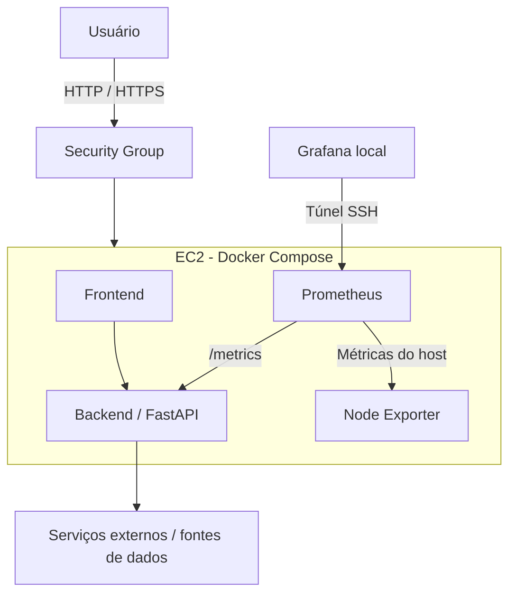

# AlertaVida — Deploy Blindado

## 1. Visão geral

O AlertaVida é um MVP de apoio à identificação e ao acompanhamento de ocorrências de trânsito. A solução reúne uma aplicação web, uma API e componentes de processamento e monitoramento.

Esta entrega apresenta a infraestrutura de implantação na AWS, o pipeline DevSecOps, a automação de deploy e a observabilidade do ambiente.

O sistema é um protótipo acadêmico: os resultados e alertas são sugestões para validação humana. Não existe integração operacional com a API do Smart Sampa, acesso a câmeras reais ou acionamento automático de serviços de emergência.

**Aplicação:** http://52.90.165.81

> O endereço utiliza o IP público atual da instância. Caso a instância seja recriada ou receba outro IP, atualize este endereço.

## 2. Arquitetura

A aplicação é executada em uma instância EC2 com Docker Compose. O frontend recebe as requisições públicas e se comunica com o backend pela rede interna do Docker.

O backend disponibiliza a API e o endpoint de métricas. Prometheus coleta as métricas da aplicação e do host por meio do Node Exporter. O Grafana é executado localmente para visualização dos dados, acessando o Prometheus por um túnel SSH.



### Componentes

| Componente | Responsabilidade |
|---|---|
| Amazon EC2 | Hospedagem da aplicação |
| Security Group | Controle de tráfego de entrada e saída |
| Docker Compose | Orquestração dos containers |
| Frontend | Interface web |
| Backend | API e processamento das requisições |
| Terraform | Provisionamento da infraestrutura |
| GitHub Actions | Verificações de segurança e build |
| systemd | Agendamento do processo de deploy |
| Prometheus | Coleta e avaliação de métricas |
| Node Exporter | Métricas do host EC2 |
| Grafana | Visualização das métricas |

## 3. Infraestrutura como código

A infraestrutura é provisionada com Terraform, utilizando o provider AWS.

A configuração contempla:

- Uma instância EC2 `t3.small`, com Amazon Linux 2023.
- Volume raiz de 8 GB, tipo gp3 e criptografado.
- IMDSv2 obrigatório.
- Security Group com portas HTTP (80) e HTTPS (443) públicas.
- Acesso SSH (22) restrito a um endereço IPv4 individual (`/32`).
- Reutilização de VPC e subnet existentes.

As portas internas da aplicação e do monitoramento não são publicadas diretamente para a internet. Prometheus é acessado por meio de túnel SSH, sem necessidade de liberar sua porta no Security Group.

O estado do Terraform, os arquivos de variáveis reais e os planos são mantidos fora do repositório. O arquivo `terraform.tfvars.example` serve como modelo e deve ser adaptado ao ambiente AWS utilizado.

Consulte [infra/terraform/README.md](../infra/terraform/README.md) para os pré-requisitos e comandos de provisionamento.

## 4. Containers e implantação

A aplicação é executada por meio do Docker Compose, com os serviços de frontend e backend separados.

O backend não precisa expor sua porta diretamente ao host: a comunicação com o frontend ocorre pela rede interna do Compose.

A stack de monitoramento é ativada pelo perfil `observability`, separando sua inicialização e recuperação das operações principais do MVP.

### Processo automatizado de deploy

O processo é dividido em duas etapas:

1. O GitHub Actions executa as verificações e builds a cada push, pull request ou execução manual.
2. Na EC2, um timer do systemd verifica periodicamente o último push aprovado na branch `main`.

O script `ops/deploy/deploy-alertavida.sh` valida o commit aprovado antes de iniciar a implantação. Também utiliza bloqueio de execução concorrente, preserva as imagens anteriores e verifica a saúde dos serviços após a atualização.

Se a implantação falhar, o script tenta restaurar o commit e as imagens anteriores. O estado do deploy só é atualizado depois que as verificações de saúde são aprovadas.

O monitoramento é reconciliado separadamente. Uma falha na inicialização do Prometheus ou do Node Exporter não deve provocar rollback de uma implantação saudável do MVP.

### Proteção de credenciais

O arquivo de ambiente da aplicação fica no servidor, em:

`/etc/alertavida/alertavida.env`

O arquivo possui permissões restritas e não é versionado. Durante a execução do Compose, o script de deploy disponibiliza temporariamente o arquivo no caminho esperado pela aplicação e remove o link simbólico ao finalizar.

Credenciais e segredos utilizados pelo pipeline devem ser armazenados nas configurações de Secrets do GitHub, nunca diretamente no código ou nas imagens.

## 5. Pipeline DevSecOps

O workflow está em `.github/workflows/deploy-blindado.yml`.

As verificações são executadas automaticamente nos eventos configurados no GitHub Actions.

| Ferramenta | Finalidade |
|---|---|
| Gitleaks | Identificação de credenciais e segredos expostos |
| Semgrep | Análise estática de segurança do código |
| Docker Buildx | Construção das imagens |
| Trivy | Análise de vulnerabilidades nas imagens |

O Semgrep utiliza a configuração `p/default` para analisar o diretório `mvp/`.

O Trivy verifica vulnerabilidades de severidade alta e crítica (`HIGH` e `CRITICAL`), considerando a configuração de vulnerabilidades ainda sem correção.

O workflow valida e constrói as imagens. A implantação na EC2 é realizada pelo mecanismo independente baseado em systemd, que consulta o resultado do workflow antes de aceitar um commit.

## 6. Observabilidade

A stack de observabilidade utiliza Prometheus e Node Exporter no servidor, com Grafana executado localmente.

O Prometheus coleta métricas a cada 30 segundos:

- Backend: métricas HTTP expostas pelo endpoint `/metrics`.
- Host EC2: métricas disponibilizadas pelo Node Exporter.

O dashboard do Grafana apresenta os quatro sinais fundamentais de monitoramento:

| Sinal | Indicador |
|---|---|
| Latência | Percentil 95 das requisições |
| Tráfego | Requisições por segundo |
| Erros | Percentual de respostas HTTP 5xx |
| Saturação | Utilização de CPU do host |

Também existe um painel adicional de disponibilidade do backend.

### Alertas configurados

- **Backend indisponível:** quando o Prometheus identifica que o serviço deixou de responder.
- **Taxa de erros elevada:** quando a proporção de respostas HTTP 5xx ultrapassa o limite configurado.
- **Latência elevada:** quando o percentil 95 ultrapassa o limite configurado.

Os alertas possuem condições e períodos de avaliação definidos em `ops/observability/alerts.yml`.

### Acesso ao Grafana

O Grafana é executado localmente, separado da instância EC2. Para acessar as métricas do servidor, é necessário abrir um túnel SSH:

```bash
ssh -L 9090:127.0.0.1:9090 ec2-user@IP_PUBLICO_DA_EC2
```

Com o túnel ativo, o Grafana fica disponível em:

`http://localhost:3000`

A configuração local está em `compose.grafana.local.yaml`.

Consulte [ops/observability/README.md](observability/README.md) para os detalhes de configuração, validação e recuperação.

## 7. Segurança e responsabilidade compartilhada

A segurança da solução é dividida entre a infraestrutura fornecida pela AWS e as configurações mantidas pela equipe do projeto.

| AWS | Equipe do projeto |
|---|---|
| Segurança física dos datacenters | Segurança do sistema operacional convidado |
| Hardware e infraestrutura física | Configuração do Docker e containers |
| Infraestrutura de virtualização | Configuração da aplicação |
| Infraestrutura dos serviços contratados | Security Groups e controle de acesso |
| Disponibilidade da infraestrutura conforme o serviço | Proteção de credenciais, atualizações e monitoramento |

Medidas adotadas no projeto:

- Restrição do acesso SSH a um endereço IPv4 `/32`.
- Ausência de exposição pública das portas internas do backend e do monitoramento.
- Obrigatoriedade de IMDSv2.
- Volume raiz criptografado.
- Segredos fora do repositório e das imagens.
- Verificações automatizadas de segurança no pipeline.
- Acesso ao Prometheus por túnel SSH.

## 8. Privacidade e LGPD

O MVP é um protótipo acadêmico e não possui integração operacional com câmeras ou sistemas reais de vigilância pública.

A utilização de dados deve respeitar os princípios da LGPD, especialmente finalidade, necessidade, segurança e prevenção.

Para a entrega, devem ser identificadas as fontes de dados utilizadas, a existência ou não de dados pessoais e a região em que ficam armazenados. Dados pessoais ou registros que permitam identificar indivíduos não devem ser incluídos em evidências públicas sem autorização e tratamento adequado.

## 9. Estimativa de custos

A infraestrutura utiliza uma instância EC2 `t3.small` e um volume EBS gp3 de 8 GB.

Os principais itens a considerar na estimativa são:

| Recurso | Critério de cobrança |
|---|---|
| EC2 `t3.small` | Tempo de execução da instância |
| EBS gp3 | Capacidade provisionada do volume |
| IPv4 público | Cobrança aplicável ao endereço público |
| Transferência de dados | Volume de dados transferidos para fora da AWS |

A estimativa deve considerar a região AWS utilizada, o período de execução e as condições do ambiente acadêmico AWS Academy / Learner Lab.

Os valores finais devem ser preenchidos com base na AWS Pricing Calculator ou nos valores efetivamente apresentados pelo ambiente utilizado. A utilização de créditos acadêmicos não representa necessariamente o custo comercial equivalente.

## 10. Como reproduzir o ambiente

### Pré-requisitos

- Conta e credenciais AWS com permissões para os recursos necessários.
- AWS CLI configurada.
- Terraform instalado.
- Docker Engine e Docker Compose v2 no servidor.
- Repositório GitHub e permissões necessárias para configurar o pipeline.
- Arquivo de ambiente da aplicação configurado no servidor.

### Provisionamento

1. Acesse `infra/terraform/`.
2. Prepare o arquivo `terraform.tfvars` fora do repositório.
3. Configure VPC, subnet, chave SSH e endereço IPv4 autorizado.
4. Inicialize o Terraform utilizando o caminho externo para o estado.
5. Execute `terraform plan` e revise o plano.
6. Execute `terraform apply` após conferir os recursos.

Os comandos completos estão em [infra/terraform/README.md](../infra/terraform/README.md).

### Deploy

1. Configure os Secrets necessários no GitHub.
2. Verifique o workflow `Deploy Blindado`.
3. Envie as alterações para a branch `main`.
4. Aguarde a conclusão bem-sucedida do workflow.
5. O timer da EC2 identificará o commit aprovado e executará o processo de deploy.
6. Verifique os logs do serviço systemd e a disponibilidade do MVP.

### Observabilidade

1. Ative o perfil `observability` no Docker Compose da EC2.
2. Confirme que Prometheus e Node Exporter estão saudáveis.
3. Abra o túnel SSH para a porta local 9090.
4. Inicie o Grafana local.
5. Confira os targets do Prometheus e os painéis do dashboard.

## 11. Evidências da entrega

As evidências devem demonstrar, de forma verificável:

- Pipeline DevSecOps concluído com sucesso.
- Execução bloqueada por uma falha de segurança e execução corrigida, quando aplicável.
- Recursos provisionados pelo Terraform.
- Security Group com SSH restrito.
- Aplicação acessível pelo endereço público.
- Containers e health checks em funcionamento.
- Targets do Prometheus ativos.
- Dashboard do Grafana com métricas.
- Pelo menos um alerta efetivamente disparado.
- Estimativa de custos da infraestrutura.

As capturas e demais evidências devem ser organizadas na documentação da entrega, sem expor credenciais, tokens, dados pessoais ou informações sensíveis da infraestrutura.

---

**Documentação complementar**

- [Terraform](../infra/terraform/README.md)
- [Observabilidade](observability/README.md)
- [Repositório do projeto](https://github.com/guidxs/AlertaVida)