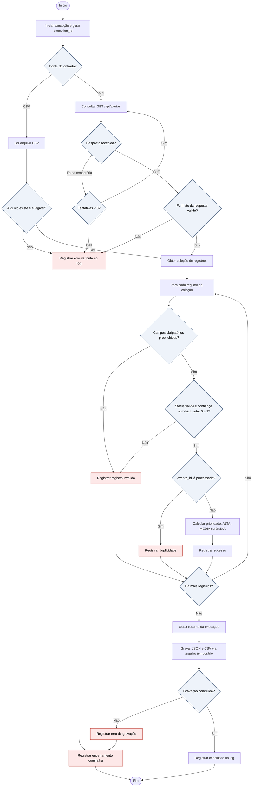

# AlertaVida — Robotic Process Automation (RPA)

Componente de Robotic Process Automation do AlertaVida, desenvolvido para a Global Solution FIAP 2026.2 (Engenharia de Software, 2º semestre de 2026).

## Integrantes

- Guilherme Doretto Sobreiro — RM 99674
- Guilherme Fazito Ziolli Sordili — RM 550539

## 1. Descrição

O AlertaVida é uma solução tecnológica que propõe usar visão computacional e análise de dados para identificar possíveis acidentes de trânsito em sistemas de câmeras urbanas, gerar alertas e encaminhá-los às equipes responsáveis pela verificação e pelo eventual acionamento dos serviços de emergência. A proposta é que a solução possa ser integrada à infraestrutura de monitoramento de diferentes municípios, contribuindo para identificar ocorrências mais rapidamente e encaminhar melhor as possíveis vítimas.

O AlertaVida utiliza visão computacional para identificar possíveis acidentes de trânsito em vídeos e gerar alertas para uma central de monitoramento. Este componente automatiza a tarefa operacional que vem depois da geração dos alertas: receber os alertas em lote, validar os campos, remover duplicidades, verificar status e confiança, definir uma prioridade operacional, registrar sucessos e erros e produzir dados estruturados para consulta.

O RPA **não detecta acidentes**, **não confirma ocorrências reais** e **não aciona** polícia, SAMU ou outro serviço de emergência. O resultado é um apoio operacional e a decisão final permanece humana.

## Ficha do produto

| Campo | Descrição |
|---|---|
| **Nome do produto** | AlertaVida |
| **Cidadão e território** | Pessoas envolvidas em acidentes de trânsito em áreas urbanas, com aplicação prevista para centrais de monitoramento municipais. |
| **Problema, em uma frase** | Possíveis acidentes podem demorar para ser identificados, avaliados e encaminhados às equipes responsáveis. |
| **Proposta de valor** | Transformar sinais capturados por câmeras em alertas contextualizados, com triagem assistida por IA, referências de apoio e dados territoriais para orientar a validação humana. Uma automação (RPA) valida os alertas em lote, remove duplicidades e atribui uma prioridade operacional (ALTA, MEDIA ou BAIXA) por regra explícita, para ordenar a atenção da equipe. |
| **Automação (RPA)** | Processo em Python que recebe alertas por CSV de demonstração ou pela API do MVP (`GET /api/alertas`, com até três tentativas), valida campos, status e confiança, identifica duplicidades pelo `evento_id`, calcula a prioridade e registra sucessos e exceções. Gera `rpa/output/alertas_priorizados.json`, `rpa/output/alertas_priorizados.csv` e o log `rpa/logs/processamento.jsonl`. O resultado da última execução pode ser consultado em `GET /api/rpa/ultima-execucao`. O RPA não detecta acidentes, não confirma ocorrências e não aciona serviços de emergência: a decisão final é humana. |
| **Arquitetura: componentes** | Câmeras e vídeos de ocorrências → modelo de visão computacional → API FastAPI do MVP → RPA em Python (leitura de `/api/alertas` ou CSV, validação, duplicidade, prioridade, JSON, CSV e log; resultado em `/api/rpa/ultima-execucao`) → painel React/Vite → módulo GenAI com recuperação de fontes (RAG), geração e validação de JSON → Databricks SQL Warehouse, mapa, indicadores e central de triagem. |
| **Fontes de dados** | Vídeos de acidentes usados no desenvolvimento, eventos e indicadores armazenados no Databricks SQL Warehouse e base documental institucional em `base/trechos.jsonl`/`base/fontes.csv`, incluindo SAMU, legislação de trânsito, PRF e orientações de emergência. Para o RPA: alertas da API do MVP e o arquivo CSV de demonstração `rpa/data/alertas_exemplo.csv`, com dados simulados e sem dados pessoais. |
| **Modelos de IA utilizados** | YOLO11n personalizado para detecção de acidentes; Qwen/Qwen2.5-1.5B-Instruct para geração local; `intfloat/multilingual-e5-small` para busca semântica; adaptador LoRA opcional para a configuração RAG + LoRA. O RPA não usa modelo de IA: aplica regras determinísticas de validação e prioridade. |
| **URL do MVP e repositório** | MVP: http://107.21.51.139 · MVP local: http://localhost:5173/ · GenAI local: http://localhost:8001/ · Repositório: https://github.com/guidxs/AlertaVida |
| **Indicadores de impacto** | Quantidade de ocorrências identificadas, precisão e recall das detecções, tempo entre identificação e encaminhamento, tempo de triagem, taxa de JSON válido, citação correta das fontes e taxa de recusa quando faltam evidências. No RPA, por execução: total de entrada, processados, inválidos, duplicados e distribuição por prioridade (ALTA, MEDIA e BAIXA). |
| **ODS conectados** | **ODS 3 — Saúde e Bem-Estar:** apoia a identificação e o encaminhamento mais rápidos de possíveis acidentes.<br>**ODS 9 — Indústria, Inovação e Infraestrutura:** aplica IA, dados e infraestrutura digital a um desafio de segurança viária.<br>**ODS 10 — Redução das Desigualdades:** busca apoiar o acesso mais equitativo à ajuda, sem depender da capacidade financeira da pessoa. |


## Adendo: disponibilidade do MVP
O MVP foi implantado por meio do AWS Academy Learner Lab, em razão dos créditos disponíveis.
Por esse motivo, o servidor permanece ligado por apenas 4 horas e depois é desligado
automaticamente, de modo que a aplicação pode estar fora do ar quando o endereço
http://107.21.51.139 for acessado. Caso queira ver a aplicação em funcionamento, basta entrar em
contato pelo Teams para que o ambiente seja ligado.

## 2. Objetivo

Processar os alertas do AlertaVida com o mínimo possível de intervenção humana, gerando dados validados, sem duplicidades, priorizados por uma regra explícita e rastreáveis por log.

### Classificação das capacidades

| Categoria | Itens |
|---|---|
| Implementada | Leitura por CSV ou pela API do MVP; até 3 tentativas na API; validações; duplicidade por `evento_id`; regra de prioridade; log; saídas JSON e CSV; gravação por arquivo temporário; endpoint `GET /api/rpa/ultima-execucao` no backend |
| Descrita (fora do RPA) | Detecção por visão computacional; confirmação, decisão e acionamento de emergência (humanos); integração com câmeras ou sistemas reais |
| Simulada | CSV de demonstração, resultados da demonstração e dados do vídeo; sem dados pessoais e sem ocorrências reais |

## 3. Arquitetura

```text
CSV de demonstração ─┐
                     ├─> Processo RPA ──> rpa/output/alertas_priorizados.json
API do MVP ──────────┘   (validação,      rpa/output/alertas_priorizados.csv
GET /api/alertas          duplicidade,    rpa/logs/processamento.jsonl
                          prioridade,              │
                          log)                     v
                                      Backend do MVP: GET /api/rpa/ultima-execucao
                                                   │
                                                   v
                                      Analista da central (decisão humana)
```

### Fluxo do processo

Legenda: círculo = início/fim (evento); retângulo = tarefa; losango = decisão (gateway exclusivo); tarefa em vermelho = tratamento de exceção. Fluxo em notação inspirada no BPMN, desenhado em Mermaid.



## 4. Pré-requisitos

- Repositório clonado: https://github.com/guidxs/AlertaVida
- Python 3.11 (biblioteca padrão: argparse, csv, json, sys, time, uuid, pathlib; urllib.request e urllib.error para a API; unittest para os testes)
- Para a fonte API: backend do MVP em execução em `http://localhost:8000`
- Permissão de escrita em `rpa/output/` e `rpa/logs/`

## 5. Instalação

```bash
git clone https://github.com/guidxs/AlertaVida.git
cd AlertaVida
python -m venv .venv
.venv\Scripts\activate        # Windows (PowerShell)
```

Não versione arquivos `.env`, credenciais ou tokens.

## 6. Execução

### 6.1 Por CSV

O CSV de demonstração contém os campos `evento_id`, `tipo_ocorrencia`, `data_evento`, `confianca` e `status`. Exemplo com **dados simulados**:

O arquivo de exemplo (`rpa/data/alertas_exemplo.csv`) contém quatro registros **simulados**, com os campos `evento_id`, `tipo_ocorrencia`, `data_evento`, `confianca` e `status`; o quarto repete um `evento_id` já processado.

```bash
python rpa/src/processar_alertas.py --csv rpa/data/alertas_exemplo.csv
```

### 6.2 Por API

Com o backend do MVP em execução:

```bash
curl http://localhost:8000/api/alertas
python rpa/src/processar_alertas.py --api-url http://localhost:8000
```

Na consulta à API, até 3 tentativas são feitas em caso de falha temporária.

## 7. Regras

### Validação

- Campos obrigatórios: `evento_id`, `tipo_ocorrencia`, `data_evento`, `confianca` e `status`.
- `confianca` deve ser numérica e estar entre 0 e 1.
- `status` deve ser `PENDENTE`, `CONFIRMADO` ou `DESCARTADO`.
- Registros com o mesmo `evento_id` são tratados como duplicados (a primeira ocorrência é mantida).

### Prioridade

| Prioridade | Condição |
|---|---|
| ALTA | status `PENDENTE` e confiança maior ou igual a 85% |
| MEDIA | status `PENDENTE` ou `CONFIRMADO` e confiança maior ou igual a 70% |
| BAIXA | todos os demais casos |

As condições são avaliadas na ordem ALTA, MEDIA, BAIXA:

```text
se status == "PENDENTE" e confianca >= 0.85:
    prioridade = "ALTA"
senao se status em ("PENDENTE", "CONFIRMADO") e confianca >= 0.70:
    prioridade = "MEDIA"
senao:
    prioridade = "BAIXA"
```

### Estruturas de repetição e decisão

- Repetição: para cada registro da coleção; nova tentativa na consulta à API (máximo de 3).
- Decisão: fonte de entrada, falha temporária, campos obrigatórios, status e confiança, duplicidade, prioridade e conclusão da gravação.

## 8. Saídas

| Arquivo | Conteúdo |
|---|---|
| `rpa/output/alertas_priorizados.json` | Resumo da execução e lista dos alertas processados |
| `rpa/output/alertas_priorizados.csv` | `evento_id`, `tipo_ocorrencia`, `data_evento`, `confianca`, `status` e `prioridade` |
| `rpa/logs/processamento.jsonl` | Um registro JSON por linha, com `timestamp`, `execution_id`, `evento` (INICIO, SUCESSO, DUPLICADO, INVALIDO, CONCLUIDO) e `mensagem` |

Resultado do CSV de exemplo: `total_entrada` = 4, `total_processados` = 3, `duplicados` = 1, `invalidos` = 0 e prioridades ALTA = 1, MEDIA = 1 e BAIXA = 1 (EVT-DEMO-001 ALTA, EVT-DEMO-002 MEDIA e EVT-DEMO-003 BAIXA).

## 9. Exceções

| Situação | Tratamento |
|---|---|
| CSV ausente | Erro da fonte registrado; execução termina com falha |
| API indisponível | Até 3 tentativas; depois, erro registrado e falha |
| Resposta da API inválida | Tratada como erro da fonte |
| Campo obrigatório vazio | Registro rejeitado como inválido; o lote continua |
| Status desconhecido | Registro rejeitado como inválido |
| Confiança não numérica | Registro rejeitado como inválido |
| Confiança fora de 0 a 1 | Registro rejeitado como inválido |
| Evento duplicado | Primeira ocorrência mantida; as demais contadas como duplicadas |
| Falha na gravação | Erro registrado; execução termina com falha |
| Gravação parcial | Gravação em arquivo temporário, que só vira arquivo final após a conclusão |

## 10. Testes

| Cód. | Cenário | Resultado esperado |
|---|---|---|
| T01 | Prioridade ALTA (PENDENTE, 0,91) | Prioridade ALTA |
| T02 | Prioridade MEDIA (CONFIRMADO, 0,76) | Prioridade MEDIA |
| T03 | Prioridade BAIXA (DESCARTADO, 0,62) | Prioridade BAIXA |
| T04 | Evento duplicado | Segundo registro rejeitado |
| T05 | Campo obrigatório vazio | Registro inválido |
| T06 | Confiança fora do intervalo (1,20) | Registro inválido |
| T07 | Confiança não numérica | Registro inválido |
| T08 | Status inválido | Registro inválido |
| T09 | Execução com CSV | 3 processados e 1 duplicado; saídas geradas |
| T10 | `GET /api/rpa/ultima-execucao` | Retorna o resultado da última execução |
| T11 | CSV ausente | Erro da fonte registrado |
| T12 | API indisponível | 3 tentativas e erro registrado |

```bash
python rpa/tests/test_processar_alertas.py   # 5 testes (unittest)
```

## 11. Integração com o MVP

- **Entrada:** `GET http://localhost:8000/api/alertas`.
- **Saída:** o backend possui o endpoint `GET /api/rpa/ultima-execucao`, que permite consultar o resultado da última execução do RPA.

```bash
curl http://localhost:8000/api/rpa/ultima-execucao
```

## 12. Segurança e LGPD

- Não são coletados nem exibidos CPF, telefone, endereço ou dados médicos.
- A demonstração usa dados simulados; não há ocorrências reais.
- Credenciais, arquivos `.env` e tokens não são expostos nem versionados.
- O log não registra dados sensíveis.
- `evento_id` e `execution_id` são identificadores técnicos.
- O RPA não realiza acionamento de emergência.
- Uma pessoa permanece no processo de confirmação; a prioridade é apoio operacional, não uma decisão automática final.

## 13. Vídeo demonstrativo

https://www.youtube.com/watch?v=cO_Kby4aINg


## 14. Referências

- Repositório: https://github.com/guidxs/AlertaVida

---

**AlertaVida · FIAP Global Solution 2026.2 · Robotic Process Automation**
